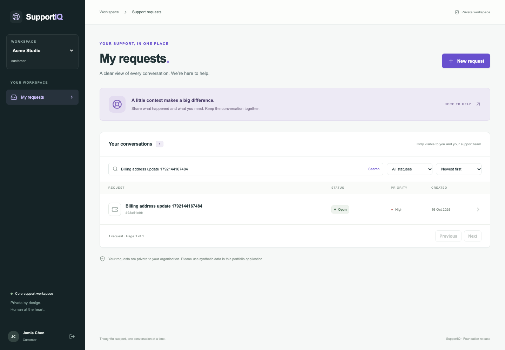

# SupportIQ

A full-stack portfolio application for private, organisation-scoped customer support. Built with synthetic data for learning and interviews. **Stage 1 is implemented:** registration, server-side sessions, controlled customer onboarding, and customer ticket creation/list/detail. AI, agent replies, document uploads, and reporting are future stages, not demonstration mocks.



## Local setup

Prerequisites: Node **22.18+ on the 22.x line**, pnpm **10.34.7**, Docker Desktop/Engine with Compose. Dependencies are pinned; see [version decisions](docs/versions.md). No cloud account or AI provider is needed.

```sh
npm install --global pnpm@10.34.7
pnpm install --frozen-lockfile
pnpm env:setup
pnpm infra:up
pnpm db:generate
pnpm db:migrate
pnpm db:seed
pnpm dev
```

Open **http://localhost:3000**. Use localhost consistently: the configured CSRF origin deliberately rejects 127.0.0.1 as a different browser origin. API Swagger UI: **http://127.0.0.1:4000/docs**, OpenAPI JSON: `/docs-json`. Readiness: `/health/ready`; liveness: `/health/live`.

`env:setup` creates `.env` only if absent, using random local credentials. Existing files are preserved. Open `.env` locally to find `SEED_PASSWORD`; do not share or commit it. Seeded accounts include `customer@acme.example`, `admin@acme.example`, and equivalents for Northstar; [full list and walkthrough](docs/demo.md). Seeding is repeatable and preserves existing passwords. Changing SEED_PASSWORD does not reset existing accounts.

MinIO is built from its official tagged source because both official prebuilt registries rejected image pulls during implementation. The first build downloads a Go toolchain image and dependencies and can take several minutes. It is local development infrastructure. PostgreSQL and Mailpit can be started first:

```sh
docker compose --env-file .env -f infra/compose.yml up -d postgres mailpit
# Later, build/start storage:
docker compose --env-file .env -f infra/compose.yml up -d --build minio
```

Infrastructure is bound to loopback: PostgreSQL `5433`, Mailpit UI `8025`/SMTP `1025`, MinIO API `9100`/console `9101`. MinIO and Mailpit run, but application attachments and email flows are not implemented yet. MinIO contains no application bucket or public policy in Stage 1.

If a port is occupied, update Compose and the matching local configuration. Docker only runs infrastructure; the Next/Nest processes run on the host. `Ctrl+C` stops development servers. `pnpm infra:down` stops containers and preserves volumes. **Only when you intend to erase local database/storage data**, use `docker compose --env-file .env -f infra/compose.yml down -v`. PostgreSQL initialization creates the separate test database only on a new volume; on a retained pre-existing volume, create `supportiq_test` through `docker compose ... exec postgres createdb -U supportiq supportiq_test` if absent.

## Workflows

1. Register an organisation. Registration creates its administrator membership and a server-side session.
2. Open Customer access, create a private link, and share it directly. The URL fragment keeps the token out of HTTP paths, referrers and access logs. Each link is single-use, expires in 48 hours, and grants only CUSTOMER membership.
3. Open the link in a separate browser profile to register a customer, or sign in and reopen the link to join with an existing account.
4. Create a request, search/filter the paginated list, and open its persisted public conversation. Another customer's ticket ID is inaccessible.
5. Sign out to revoke the current session. Browser reloads retain valid sessions; expired/revoked sessions fail at the API.

The staff ticket overview currently supports reading public ticket information. Replying, resolving, internal-note creation and assignments are Stage 2. The UI says so explicitly.

## Structure and design

```text
apps/web              Next.js, React, Tailwind; responsive customer/administrator UI
apps/api/src          NestJS auth, organisation and ticket modules
apps/api/prisma       Schema, checked-in SQL migration and synthetic seeds
packages/contracts    Public Zod request schemas and safe response types
infra                 PostgreSQL/pgvector, source-built MinIO, Mailpit
scripts               Safe local configuration and isolated test setup
.github/workflows     CI definition (not yet run on GitHub)
docs                  Plan, progress, architecture, security, versions, screenshots
```

The browser calls a same-origin `/api` proxy. Nest authorises every protected request against persisted sessions and memberships. Composite foreign keys add a database-level barrier against tenant mixing. Ticket/message/history creation is atomic. A unique customer/request ID makes submission retries safe. Responses project public fields rather than exposing database objects. See [architecture](docs/architecture.md) and [authorisation/security](docs/security.md).

## Verification

Use a **separate database whose name ends in `_test`** in TEST_DATABASE_URL. The API test suite truncates test tables; guards reject the configured development database. Never point either test command at valuable data.

```sh
pnpm db:generate
pnpm db:test:prepare
pnpm format:check
pnpm lint
pnpm typecheck
pnpm test:api
pnpm test:web
pnpm build
pnpm exec playwright install chromium
pnpm test:e2e
```

Jest exercises a real PostgreSQL database. React Testing Library/Vitest covers form submissions, pending/error states, and retry identity. Playwright starts isolated servers on localhost:3100 and 127.0.0.1:4100, seeds synthetic test users, and exercises actual UI/API persistence. It saves real screenshots to docs/screenshots. Traces are disabled to keep credentials/tokens out of artifacts. Browser screenshots may contain synthetic ticket titles, never real customer data. E2E uses a fixed **test-only** seed password and no AI mocks are needed at this stage.

GitHub Actions is configured for formatting, lint, types, clean-database migrations, backend/frontend tests, builds and Chromium flows. This is configuration, not a claim that hosted CI has run. [Actual executed checks and outstanding work](docs/progress.md).

## Limitations and delivery

This is not production-ready. Remaining stages cover agent workflows, team invitation/reset email, attachments, ingestion, AI drafts/citations, reporting, wider accessibility/security evaluation and deployment. Local MinIO is built from an older official release; maintenance and security must be re-evaluated before any deployment. No public service, GitHub repository, AWS resources, paid provider, or model download was created.

Deployment planning is tracked in [deployment-readiness](docs/deployment-readiness.md); real AWS pricing research and cost estimates belong to Stage 8 when the deployable topology is known. No unverified price estimates are included.
