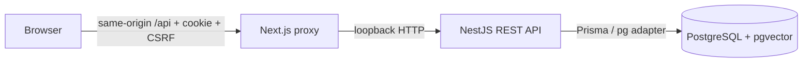

# Architecture and data flow

Stage 1 is one frontend, one modular backend and one PostgreSQL database. Next rewrites `/api/*` to a loopback Nest process; the browser has one origin. PostgreSQL transactions persist identity and support data. No in-memory fake database, email simulation, or AI fallback exists.

User has many Memberships; Organisation has many Memberships. Each membership stores its organisation role. Sessions identify users, then each organisation operation looks up the current membership again. Membership revocation takes effect immediately without trusting cached client roles.

Ticket stores organisationId and customerId (a membership). A composite foreign key requires the customer membership to belong to that organisation. Message and TicketEvent both reference ticket and author/actor through matching organisation IDs. The migration creates pgvector through SQL; no vector columns or fake embeddings are created yet.

Ticket creation uses Prisma nested writes in one transaction: ticket, first public message, CREATED event. The request UUID is unique per customer. An identical retry returns the existing ticket; a changed payload reusing that ID returns 409. Concurrent duplicate submissions may receive 409 and must refresh. No generic PATCH endpoint exists in Stage 1, so arbitrary field updates are impossible.

Auth registration uses a nested user/organisation/membership transaction. Customer onboarding conditionally claims an unused, unexpired token inside the same transaction as membership/user creation. The conditional update makes concurrent claims safe. A failed transaction does not consume the link. Existing memberships retain their existing role.

Lists use bounded pagination (max 50) and allowlisted sort/status. Subject search is case-insensitive and always tenant/owner scoped; it never searches internal messages. Stable secondary ID ordering avoids ambiguous sort ties. Concurrent changes may shift offset pages; cursor pagination is a future option if traffic warrants it.

Explicit public projections omit token/password fields and filter messages with internal=false. Customers cannot view other owners' ticket details even within one organisation. There is no customer-facing history endpoint yet. Agent-specific response projections and transitions arrive in Stage 2.

Future entities are intentionally deferred to the stage that implements their workflow: Invitation, PasswordResetToken (3), Attachment/KnowledgeArticle (4), DocumentVersion/SearchableChunk/IngestionJob (5), AiDraft/SourceReference (6), and reporting queries (7). Do not confuse the plan with implemented models.

The source-built local MinIO and Mailpit services are ready for later stages; Stage 1 makes no storage calls or email-delivery claims. pgvector extension availability is verified through the migration. Shared contracts include only public request schemas and safe response types; generated Prisma code remains inside the backend and is gitignored.
