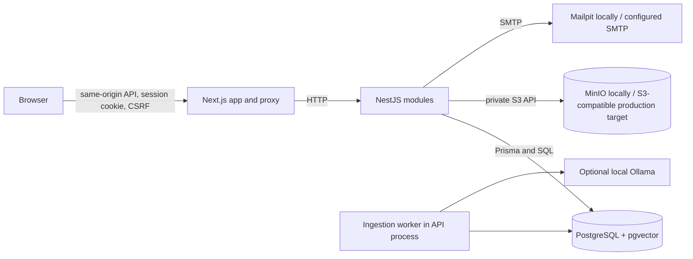

# Architecture and data flows

The application runs on the host in local development. PostgreSQL, MinIO, and Mailpit run in Docker Compose. The API polls the durable ingestion-job table in a single process; PostgreSQL row locks (`FOR UPDATE SKIP LOCKED`) allow safe job claiming if multiple API workers run. A lease allows abandoned work to be retried. Embedding and chat calls use Ollama's local HTTP API; AI is optional and is not required for tickets, team actions, or reporting.

## Isolation and transactions

Users have organisation memberships with roles. Agent memberships can be deactivated; every request resolves an active membership. Ticket customers, assignees, messages, events, attachments, documents, chunks, drafts, tags, and invitations are scoped to an organisation. Composite foreign keys enforce the tenant relationships in PostgreSQL as a second barrier after authorization queries. Customer projections filter internal messages and expose only the owner's tickets. Attachment downloads repeat membership, ownership and public-message checks before reading private storage.

Ticket creation writes the ticket, first public message and `CREATED` event in one transaction. Conversation writes use request IDs and expected ticket versions; status changes use an allowlisted transition table. Team changes and tags generate staff-visible audit events. Invitation and password-reset verifiers are random, hashed, expiring and single-use. Password reset revokes active sessions.

## Knowledge ingestion and AI

Articles and supported uploads persist extracted text and enqueue a generation-numbered job. The worker chunks source text, calls the configured embedding provider and transactionally replaces chunks for the current generation. Failed jobs retry with bounded exponential delay; administrators can request a retry. Editing or deleting a document invalidates the prior generation, so stale chunks are not searchable. Search and draft retrieval constrain organisation, `READY` state, deletion timestamp and generation in SQL. The manually maintained HNSW index is 768 dimensions, matching the configured embedding model contract.

Scanned PDFs are rejected with an explicit OCR limitation. Uploaded originals remain private. AI uses only public ticket context and retrieved excerpts; internal notes are excluded. Prompt injection text is treated as untrusted. The provider returns JSON, citation IDs are checked against retrieved source IDs, and drafts retain their source title, excerpt, document ID and generation. If evidence falls below the relevance threshold, the API saves a clear insufficient-evidence draft without asking the model to invent an answer. Staff can edit and inspect it, approve it, then separately send it. Sending also checks the ticket version. No background or automatic send path exists.

## Reporting

The API derives status and priority totals, active backlog age, current assignee workload and unassigned count, daily created-ticket series, first public staff response, and time to first resolution event from persisted tickets, messages and events. Definitions and exclusions are documented in [metrics](metrics.md). Reports are staff-only and tenant-scoped.

## Local file map

`apps/web` contains the accessible responsive UI and same-origin proxy. `apps/api/src` contains Nest modules for auth, security, customer onboarding, tickets, attachments, team, email, tags, knowledge ingestion/search, Ollama drafts and reports. `apps/api/prisma` contains schema, ordered migrations and synthetic seed data. `packages/contracts` contains shared safe schemas. `infra` contains local dependencies. `scripts` contains guarded database setup and browser seeding. `.github/workflows/ci.yml` defines checks; no hosted run is claimed.
